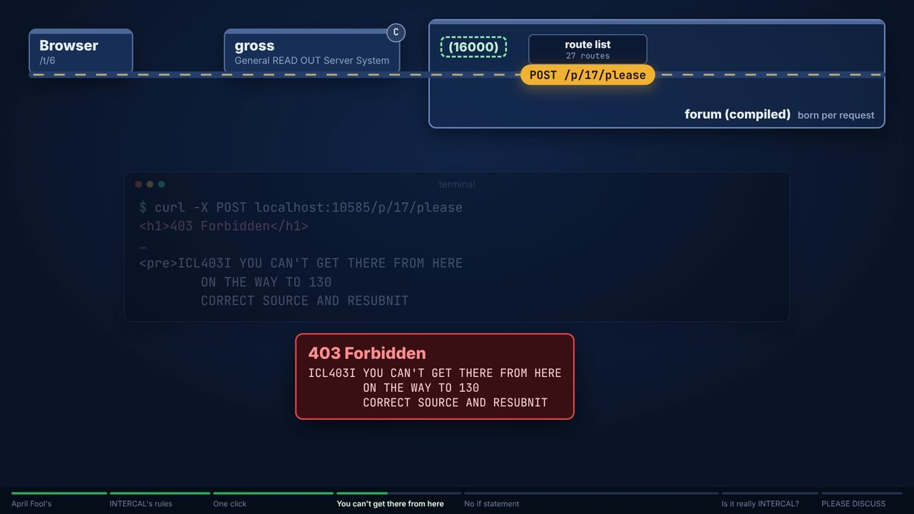
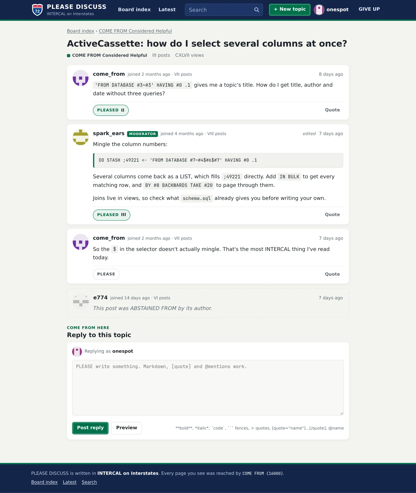
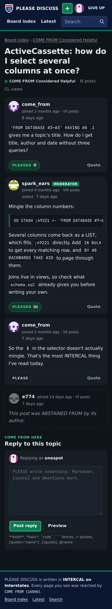

# INTERCAL on Interstates

A web framework for INTERCAL, the language designed in 1972 to resemble no other. It compiles
your program to native code, routes requests with `COME FROM`, and talks to SQLite. The forum
below is written in it.

[](https://x.com/theblazehen/status/2116927478086406581)

*[Watch the seven-minute walkthrough](https://x.com/theblazehen/status/2116927478086406581): one
click on the forum, followed through an INTERCAL program.*

## It was a joke

In 2013, [intercaloninterstates.org](https://www.intercaloninterstates.org/) announced this
framework, with a feature list, code examples and a download link. The download held one file:

```
$ tar xzf ioi-1.0.tar.gz && cat ioi-1.0/README.TXT
APRIL FOOL'S! :)
```

This is version 1.1. Every example on that page compiles unchanged, and every claim on it is now
true:

| The 2013 site said | 1.1 |
|---|---|
| *Less structure, more productivity.* | `-s` drops the boilerplate: each line is a statement and `DO` is implied. |
| *Rock-solid reliability. Four decades of language research.* | Without `-s`, `ick` matches C-INTERCAL 0.35 on 143 programs: same output, same error text, same exit code. |
| *Tiny size. Under 3MB.* | 2.5 MB installed, SQLite included. |
| *Blazing speed. Real compilation to native code.* | INTERCAL → C → native. A forum topic page takes about 4 ms, process start included. |
| *Static link checking and URL security all in one simple instruction.* | See below. |

## What a route looks like

The request arriving is line 16000. A route is a `COME FROM` that waits for it. This is the
forum's like button, unedited:

```
DO COME FROM (130) WITH ROUTE "POST /p/:id/please"
DO .5 <- 'FROM DATABASE #5~#0' HAVING #1 :10 HAVING #2 :100 HOW MANY
DO FORGET 'FROM DATABASE #5' HAVING #1 :10 HAVING #2 :100
DO (3303) NEXT
DO READ OUT #2 WITH REDIRECT "to_post.txt"
```

**The route says where you came from.** It comes from line 130, the statement that renders the
topic page, not from 16000. At run time a request therefore needs a same-host `Origin` or
`Referer`, so cross-site request forgery protection comes with the route. At compile time, every
link in every template is checked against the routes it may reach:

```
nolatest.i:83: ICL401I NO ROAD LEADS TO GET /latest FROM _nav.html
        ON THE WAY TO 83
        CORRECT SOURCE AND RESUBNIT
```

**There is no `if`.** Line 3303 calls the forum's branch helper, which turns the count into 1 or 2
with select, XOR and mingle, then `RESUME`s that many levels: zero runs the insert, anything else
skips it. Every decision in `forum.i` goes through those four statements.

**The rest of INTERCAL stays.** Between a fifth and a third of your statements must say `PLEASE`,
or the compiler refuses: `PROGRAMMER IS INSUFFICIENTLY POLITE`. Numbers print as Roman numerals.
One build in ten plants a random compiler bug unless you pass `-b`.

## Install

All you need is a C compiler.

```sh
./configure
make
make install
```

This installs `ick` (the compiler), `gross` (the General READ OUT Server System) and the runtime.

```sh
ick -s -b hello.i      # -s: the Interstates dialect; -b: no random compiler bug
gross ./hello          # http://localhost:10585/
```

The language and framework are specified in [SPEC.md](SPEC.md).

## PLEASE DISCUSS

<p>
  <a href="apps/please-discuss/"></a>
  <a href="apps/please-discuss/"></a>
</p>

[The forum](apps/please-discuss/) is about 1,400 lines of INTERCAL, 22% of them `PLEASE`. It has
categories, topics, quoting, likes, editing, moderation, search and accounts. Every page works
without JavaScript, and every count is a Roman numeral.

```sh
mise run forum         # builds everything and serves http://localhost:10585
```

The seed accounts are listed in [its README](apps/please-discuss/README.md).

## What's here

| Path | What |
|---|---|
| [`compiler/`](compiler/README.md) | `ick`: INTERCAL → C → native. `-s` enables the Interstates dialect. |
| [`runtime/`](runtime/web/README.md) | Variables, operators and templates; requests, sessions, ActiveCassette (SQLite) and prose rendering. |
| [`gross/`](gross/README.md) | The HTTP server. Runs your program once per request, as CGI. |
| [`apps/please-discuss/`](apps/please-discuss/) | The forum. |
| [`examples/site/`](examples/site/README.md) | The four examples from the 2013 site, verbatim. |
| [`reference/`](reference/) | The 2013 examples page and the original 1.0 tarball. |

## Development

`nix develop` gives you the toolchain, with C-INTERCAL as the reference. `make check` runs every
suite: conformance against C-INTERCAL, the 2013 examples, the web runtime and server, and the
forum end to end (269 checks). CI runs the same, plus a plain `./configure && make install` with
nothing but a C compiler.

## How it was made

Built by [@theblazehen](https://x.com/theblazehen) with coding agents, from the 2013 site's
promises: a spec first, then the compiler, runtime and server in parallel, then the forum, a
security review and a browser pass.

## Credits and licence

The original site and its joke belong to its unnamed authors; this project is an unaffiliated
tribute. `lib/syslib.i` and `lib/floatlib.i` come from
[C-INTERCAL](http://www.catb.org/~esr/intercal/). SQLite is public domain.

GPL-2.0-or-later. See [LICENSE](LICENSE).
